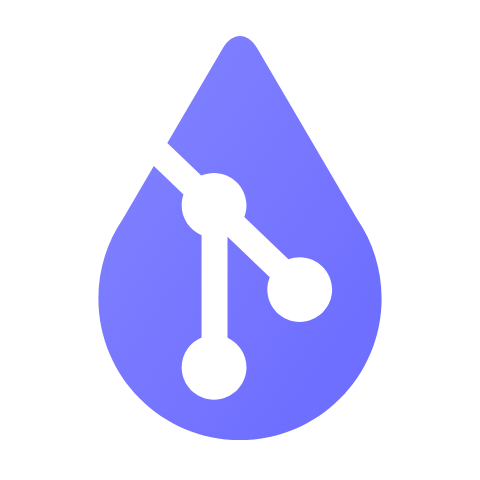
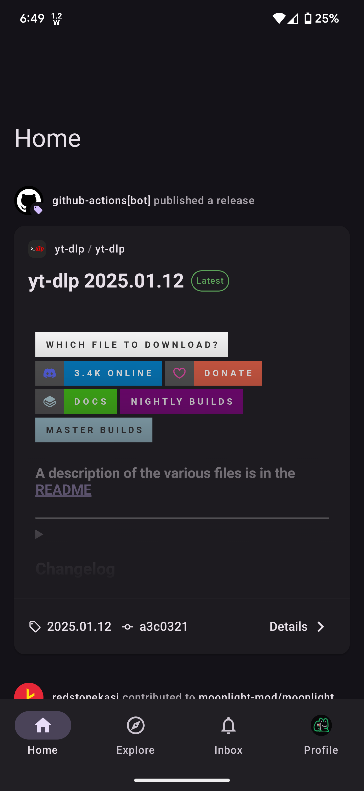
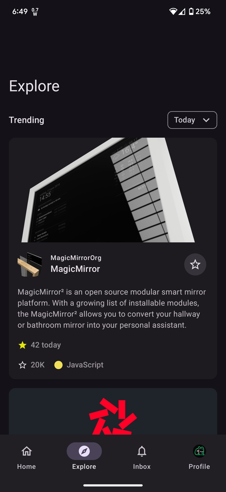
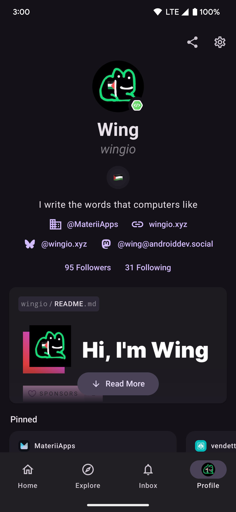
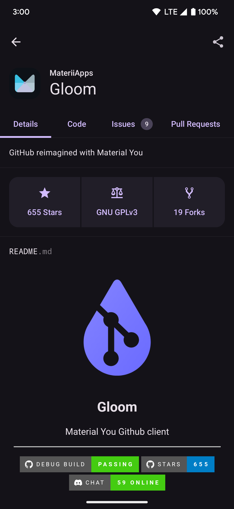

  
  
  # Gloom

  
  Material You GitHub client for Android, built with Kotlin Multiplatform and Compose
  
  ---
  
  
  
  
  
   
  
  
  

|                                                                                                                                                                                                                                                       |                                                                                                                                                                                                                                                       |
|-------------------------------------------------------------------------------------------------------------------------------------------------------------------------------------------------------------------------------------------------------|-------------------------------------------------------------------------------------------------------------------------------------------------------------------------------------------------------------------------------------------------------|
| <picture><source media="(prefers-color-scheme: dark)" srcset=".github/images/Home.png" /><source media="(prefers-color-scheme: light)" srcset=".github/images/Home-Light.png" /></picture>          | <picture><source media="(prefers-color-scheme: dark)" srcset=".github/images/Explore.png" /><source media="(prefers-color-scheme: light)" srcset=".github/images/Explore-Light.png" /></picture> |
| <picture><source media="(prefers-color-scheme: dark)" srcset=".github/images/Profile.png" /><source media="(prefers-color-scheme: light)" srcset=".github/images/Profile-Light.png" /></picture> | <picture><source media="(prefers-color-scheme: dark)" srcset=".github/images/Repo.png" /><source media="(prefers-color-scheme: light)" srcset=".github/images/Repo-Light.png" /></picture>          |

## Features

**Browse**
- Home feed with filters (repos, stars, releases, pull requests, people), explore trending repositories and developers, profiles with contribution graphs, and an inbox grouped by repository with unread and reason filters
- Repositories: code, issues, pull requests, releases, README, file viewer and a commit activity timeline
- GitHub Discussions and GitHub Projects (v2 boards)
- Gists: list, create, copy and delete

**Develop**
- GitHub Actions dashboard: workflow runs, jobs and steps, logs, cancel and re-run, run history with filters, pass rate and average duration
- Build failure alerts: get a notification when a run fails in a repository you watch (checked about every 15 minutes)
- Code editor: edit repository files, search within a file, compare changes as a diff, commit to the current branch or a new one

**App**
- Material You theming with dynamic colour, accent choices, AMOLED black and light/dark/system modes
- In-app updates: checks GitHub releases, downloads the matching APK and hands it to the Android installer (Settings > App updates)

## Installation

1. Open the [latest release](https://github.com/Baker0o7/Gloom/releases/latest) on your phone
2. Download `Gloom-vX.Y.Z-release.apk` (the `-debug.apk` is a separate debuggable build that installs next to it)
3. Allow installing from unknown sources when Android asks, then open the file
4. Check the download against `SHA256SUMS.txt` if you like

After that, Gloom can update itself from **Settings > App updates**.

> Releases are signed with a shared debug key, not a private release key. Updates install over earlier releases from v1.0.90 onwards; older builds need a one-time uninstall first.

## Token scopes

Sign in with GitHub, or with a personal access token. Some features need extra scopes:

| Feature | Scope |
|---|---|
| Gists | `gist` |
| Projects | `read:project` |
| Notifications | `notifications` |
| Private repositories, Actions and the code editor | `repo` (and `workflow` to re-run workflows) |

## Build

#### Prerequisites
  - [Git](https://git-scm.com/downloads)
  - [JDK 17](https://adoptium.net/)
  - [Android SDK](https://developer.android.com/studio)

#### Instructions

1. Clone the repo
    - `git clone https://github.com/Baker0o7/Gloom.git && cd Gloom`
2. Build the project
    - Linux/macOS: `chmod +x gradlew && ./gradlew assembleDebug`
    - Windows: `gradlew.bat assembleDebug`
3. Install on device
    - [Enable USB debugging](https://developer.android.com/studio/debug/dev-options) and plug in your phone
    - Install the APK from `app/android/build/outputs/apk/debug/`, for example with `adb install`

Set the `APP_VERSION` environment variable (for example `APP_VERSION=1.0.97`) to override the version name and code.

## Releasing

CI (`.github/workflows/build.yml`) builds the debug and release APKs on every push to `main`. To publish a release, push a commit whose message contains `[release vX.Y.Z]` and that changes a tracked file (the workflow ignores doc-only changes, so bump `.github/last-release.txt`). CI then creates the GitHub Release with both APKs and `SHA256SUMS.txt`.

## Project layout

| Module | Purpose |
|---|---|
| `api` | GitHub REST and GraphQL clients (Ktor, Apollo), DTOs |
| `shared` | Preferences, managers and platform interfaces |
| `ui` | Compose Multiplatform screens, components and theme |
| `app/android` | Android app: activity, DI wiring, notifications, updater |

## Contributing

This is an open-source project, you can do so without any programming.

Here are a few things you can do:

- [Test and report issues](https://github.com/Baker0o7/Gloom/issues/new/choose)
- [Translate the app into your language](https://crowdin.com/project/gloom)
    
License
---
Gloom is licensed under the GNU General Public License v3.0.

This is a fork of [MateriiApps/Gloom](https://github.com/MateriiApps/Gloom); thanks to the original authors.

